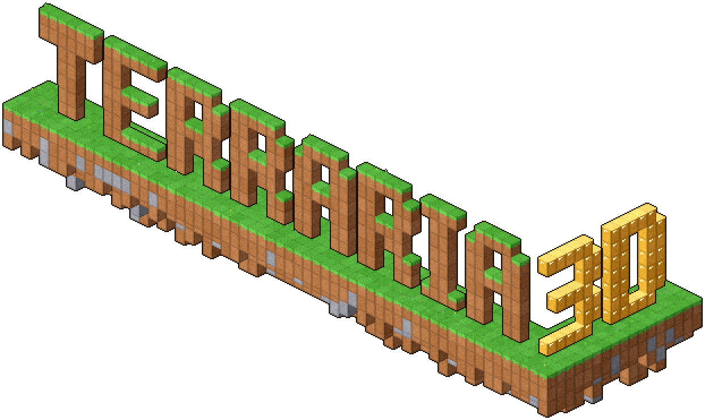
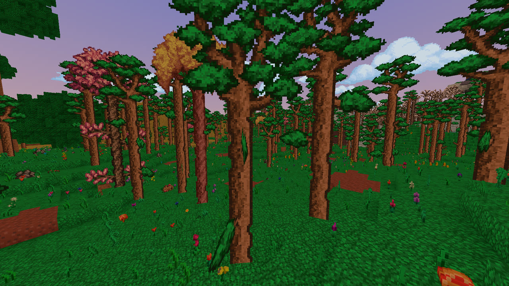
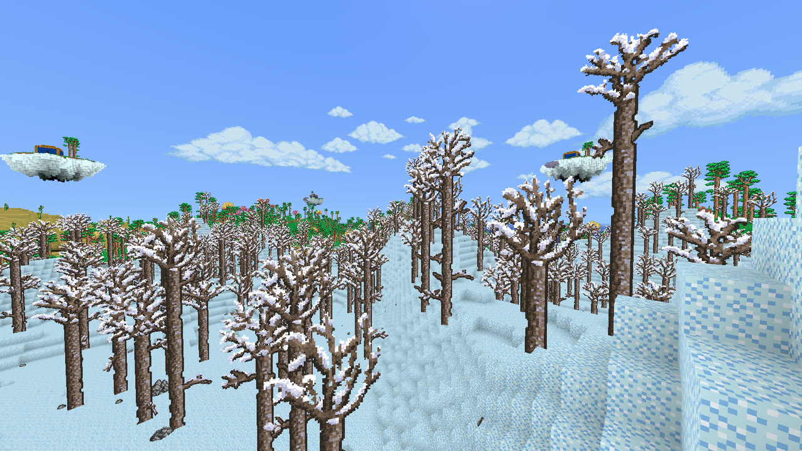
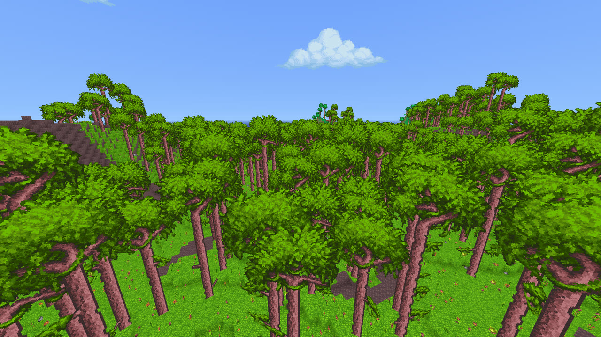
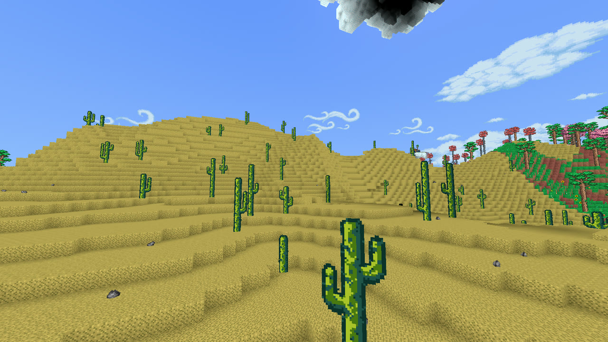
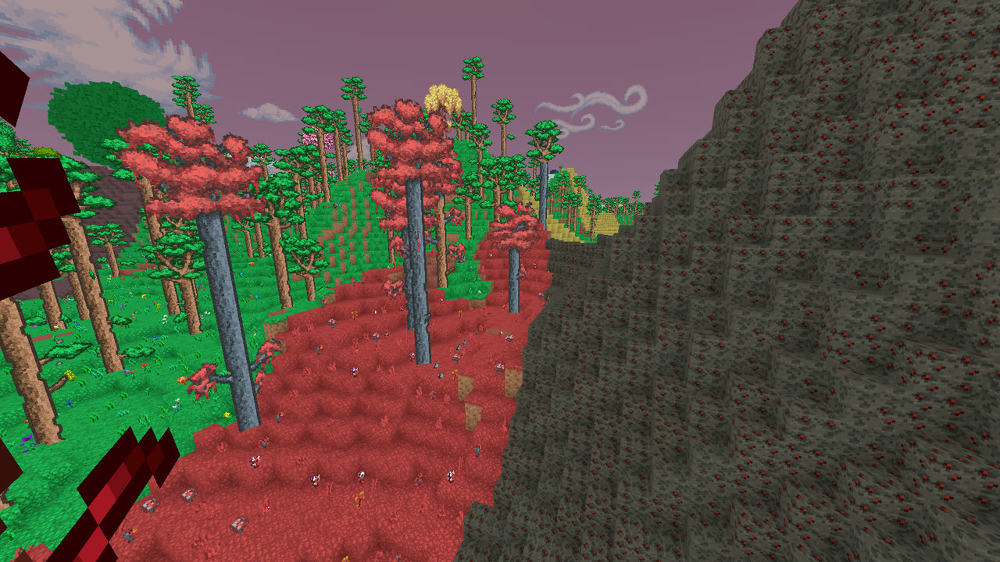
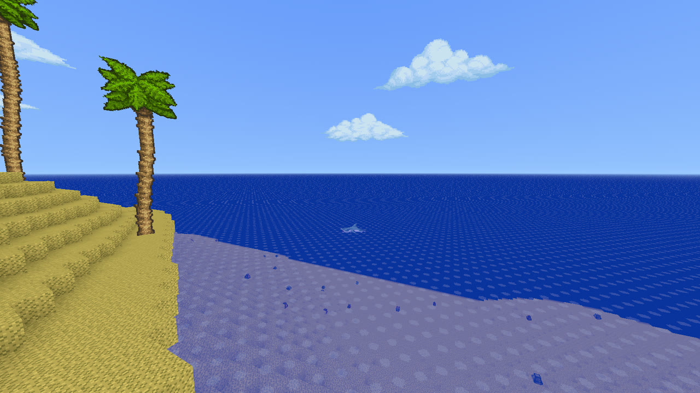
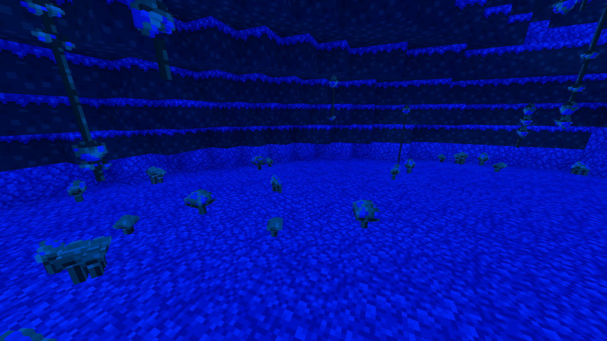
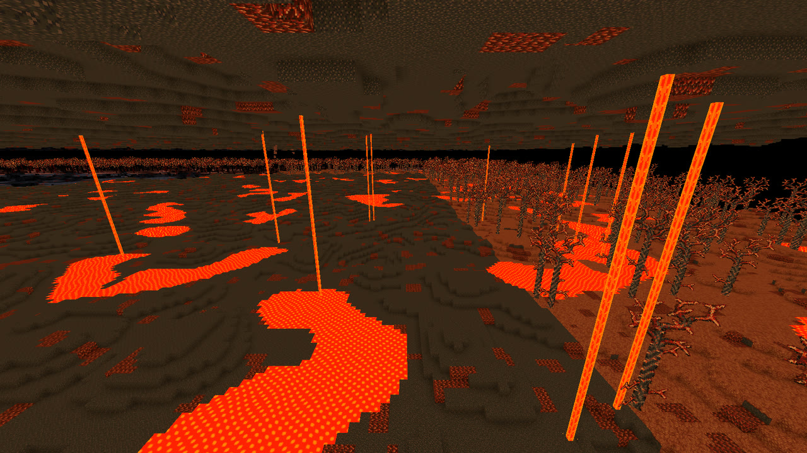

<p align="center"></p>

# Terraria 3D

A first-person, voxel 3D take on Terraria built with Godot 4.7 and a Rust voxel core,
using the original game's art, sounds, music and fonts extracted from **your own**
Terraria install. No Terraria assets are stored in this repository.

The game follows Terraria 1.4.5 as closely as it can: stats, recipes, drops, world generation
and enemy AI come from Terraria's own code and data, so anything not described here works as it
does in Terraria. This README covers what's different in 3D, what's in so far, and the tools for
working on the game.

## Install on Windows

The easiest way to play on Windows is the installer, `Terraria3D-Setup-<version>.exe`. You don't
need Rust, Python or Godot, but you do need Terraria installed (Steam or GOG): the installer holds
none of Terraria's assets and copies them from your own install.

1. Run `Terraria3D-Setup-<version>.exe`. It installs for your user only (no admin prompt) to
   `%LOCALAPPDATA%\Programs\Terraria 3D`.
2. It finds your Terraria (Steam libraries, then GOG; you can pick another folder) and extracts its
   assets into `assets\terraria\` next to `Terraria3D.exe`.
3. Start **Terraria 3D** from the Start menu.

After a Terraria update, or if Terraria wasn't installed when you ran the installer, run
**Extract Terraria assets** from the Start menu (its log is `extract\extract.log`). Uninstalling
removes the extracted assets but keeps your characters, worlds and settings
(`%APPDATA%\Godot\app_userdata\Terraria 3D`).

To make the installer yourself, see [Building the Windows installer](#building-the-windows-installer).
On Linux, or to work on the game, see [Building from source](#building-from-source).

## Screenshots

| | |
|:---:|:---:|
|  |  |
| The forest at dusk | Snow |
|  |  |
| Jungle | Desert |
|  |  |
| The Crimson | Ocean |
|  |  |
| Glowing Mushroom cavern | The Underworld |

## Controls

Defaults below; every action except Escape can be rebound under **Settings → Controls**
(title screen or pause menu). Bindings follow physical key positions, so WASD stays in
place on any keyboard layout, and the menu shows your layout's labels. Settings also has
mouse sensitivity, invert Y, field of view, view distance, far view, **UI scale (50–200%)**,
volumes and optional shaders.

| Key | Action |
| --- | --- |
| WASD / Space | Move / jump (hold for higher jumps) |
| Mouse / LMB | Look / use held item (mine, chop, attack, shoot, place, drink). Like Terraria, tools, buckets and blocks keep going while held; weapons and potions take a click each (Settings: Autofire makes everything keep going) |
| RMB | Talk to town NPCs; open chests, barrels, dressers and trash cans; open and close doors; set your spawn at a bed; check a clock; write on a sign |
| 1-0, mouse wheel | Select hotbar slot |
| Tab | Inventory and crafting (click to move stacks, right-click takes one, shift-click quick-moves; right-click armor, an accessory or a hook to put it on) |
| H | Quick heal |
| T | Throw held item |
| E | Grapple: throw the hook in your hook slot, else the first one in your inventory |
| F12 | Screenshot without the HUD (saved to `~/.local/share/godot/app_userdata/Terraria 3D/screenshots/`) |
| Shift (hold) | Drop through platforms |
| Space / Shift on a rope | Grab it and climb up / slide down (Terraria's Up and Down); move to let go, jump while moving to leap off |
| Esc | Pause menu (resume, game mode, settings, save, save & exit) |
| Space twice (creative) | Start / stop flying (Space up, Shift down) |
| MMB (creative) | Pick block: the targeted block into the hotbar |

### Characters and worlds

As in Terraria, characters and worlds are saved apart. **Single Player** lists your characters.
Pick one, then pick or create a world for it.

- **New Character:** choose a name and a difficulty. For the look, choose one of Terraria's 213
  starting hairstyles, one of its 10 clothing styles and seven colours, or press **Random**.
- **Your character keeps its things** from world to world: inventory, armor and accessories,
  piggy bank and safe, life and mana, buffs and pets. A new character starts with Terraria's
  copper shortsword, pickaxe and axe.
- **A world keeps none of your things.** You start at your bed in that world if you set one,
  otherwise at the world's spawn.
- **Difficulty** decides what a death costs:
  - **Classic** drops half your coins.
  - **Mediumcore** drops everything you carry and wear. The starting copper tools are lost.
  - **Hardcore** dies for good. The character is deleted (to the system trash) and you go back
    to the menu.

### Creative mode

Creative mode works like Minecraft's. You pick **Game mode: Creative** when creating a world,
or switch any time with the pause menu's game mode button. The mode is saved with the world.

- **No damage:** hits, falls, drowning and lava do nothing, and life and mana are hidden.
- **Flying:** double-tap jump to fly, and touch the ground to land.
- **Breaking:** blocks break in one hit (even altars), and nothing drops.
- **Nothing used up:** placed blocks, ammo, potions, mana and buckets stay.
- **Starting out:** your character brings its own things, as in any world.
- **Inventory (Tab):** shows every item under the hotbar, in tabs (Blocks, Tools, Weapons,
  Accessories, Armor, Consumables, Materials) with a search box. The full inventory has its own tab.
  - Click takes a full stack.
  - Right-click takes one.
  - Shift+click puts a stack straight into the inventory.
  - Clicking the palette with something held deletes it.

## Test world

**Test World** (under Create World, once you've picked a character) builds a flat sandbox
for trying everything. You play as your character, but with the test world's own items, so your
character's things are left as they were:

- **North:** chests holding every item (full stacks, sorted by category); crafting stations at spawn.
- **East:** an enemy arena walled 5 blocks high (above a zombie's best jump), entered through a
  wooden door, with a spawner per enemy type
  and the Eye of Cthulhu.
  Right-click a spawner to spawn one; Shift+right-click toggles auto-spawning (up to 3 alive).
- **Southeast of spawn:** two target dummies that never die and show your DPS.
- **West:** a 6-deep water pool with a natural waterfall, hammer-spring tanks (water already
  flowing, lava ready to hammer), a fenced lava pit and obsidian.
- **Far north-west:** a shimmer pool: throw items in; jump in and you sink through the ground into
  a room under it, with a rope back up.
- **Above the plaza:** two floating islands (fly up with F3): a house island with a Skyware chest
  and a lake island, both in the Space layer.
- **South-west / south-east:** a small Corruption and Crimson patch, with Shadow Orbs and
  Crimson Hearts to smash.
- **North-west / north / north-east:** a small Snow, Desert and Jungle patch.
- **South-east, down the shaft past the tower:** a mud cavern with the Glowing Mushroom biome grown
  in it (mushroom grass, giant and small glowing mushrooms, vines; its music and enemies).
- **North-east, down the shaft in the Jungle:** a bee hive (the world generator's, smaller): hive
  blocks round chambers of honey, and the larva on its stand at the bottom of the shaft.
- **North-west of the water pool:** the fishing pond, 20 x 8 cells across (full fishing power),
  with a dock of platforms along its south side. The loadout has a Reinforced Fishing Pole and
  Master Bait.
- **A fishing spot in every biome** (signposted "Fishing: ..."), each deep enough for full power:
  ponds dug into the Snow, Desert, Jungle, Corruption and Crimson patches, a honey pond in the
  Jungle, a lava pond by the fishing pond, a pond in the mushroom cavern's floor, an underground
  chamber down a shaft by the house (north-east: the Dungeon's maze fills the west underground), a
  blue brick Dungeon hall (its catches need Skeletron beaten), a cloud basin in the sky above the
  islands, and the ocean: a long strip along the far north that counts as the ocean (its music,
  enemies and fish; Terraria needs 1000 tiles of it).
- **The Angler** lives in the town's 8th house.
- **West of the gallery:** the critter pen, a glass house with a spawner for each critter, open
  grass and a pond (ducks, goldfish). The loadout has a Bug Net.
- **North of the trees:** the forest's plants and debris: a meadow with one of each, a sunflower
  patch, a pond with lily pads and cattails, and a grassy ledge with vines under it.
- **East of the forest garden:** a furnished wooden house (door, table with a candle, chair, bed,
  clock, barrel, chandelier, sawmill and loom). The dark room has cobwebs in its corners.
- **North of the house:** a library (bookcases, piano, a dresser with a candelabra, a trash can, a
  silver chandelier) with a lamp post outside. Tiki torches and a sign with a message stand by
  the house door.
- **East of the house:** hammered blocks: half blocks, a ramp staircase, an arch with
  upside-down ramps and two grass ramps.
- **Far west:** the Dungeon's entrance (blue brick), its door facing spawn, with the Old Man, and a
  small Dungeon under it (a quarter of the generator's layout steps).
- **South-west of spawn:** a staircase of wooden platforms up to a floating platform floor.
- **South:** one of every block, an ore wall labelled with required pickaxe power (gem ores in a
  second row behind), a 25-block staircase tower with a water landing pool for fall tests and a
  rope and a chain down its north wall, and a sealed dark room.

You start with top-tier gear, max life and mana. Hotkeys: **F1** help, **F2** god mode, **F3** fly
(Space up, Shift down), **F4** day/night, **F5** remove enemies, **F6** clear dropped items,
**F7** natural spawns (off by default), **F8** heal, **F9** a meteorite lands 20 blocks in front of
you. Enemies spawned here don't flee at daytime.

### The same test world in Terraria

`tools/terraria_test_world.py` builds a Terraria world laid out like the test world, for
comparing the two side by side. It starts from a fresh Journey-mode world made by Terraria's own
dedicated server, so its biomes, Dungeon, floating islands and cabins are real. It then flattens a
forest strip at spawn and builds every section in a row, west to east:

- garden
- house, library, hammered blocks
- liquid lab, dark room
- chests holding every item in `items.json`, the crafting plaza at spawn
- dummies
- arena: wired statues on switches stand in for the spawners; statue enemies drop nothing
- town, with its six NPCs housed
- fall-test tower, platforms
- block gallery, with the ore wall in its top row

Journey's enemy strength is set to Normal (1×), and Journey powers stand in for the debug keys.

```sh
cd ~/.var/app/com.valvesoftware.Steam/.local/share/Steam/steamapps/common/Terraria
./TerrariaServer.bin.x86_64 -config server.txt   # autocreate=1, difficulty=3, seed=3003, world=...;
                                                 # stop it once it says "Server started"
python3 -I tools/terraria_test_world.py template.wld ~/.var/app/com.valvesoftware.Steam/.local/share/Terraria/Worlds/3D_Compare.wld "3D Compare"
```

`tools/terraria_wld.py` reads and writes Terraria 1.4.5 world files (version 326). The world can be
checked by loading it with the dedicated server and having it save; nothing should change.

## What's different in 3D

### Scale and movement

- **A Terraria tile is 2/3 of a block,** so 1 px/tick is 2.5 blocks/s. Movement, jumps, gravity
  and fall damage follow Terraria's own code (`Player.Update`, `HorizontalMovement`,
  `JumpMovement`) at that scale: a full jump is about 4.1 blocks (6 tiles).
- **You're 2 blocks tall** (3 tiles in Terraria), so doors are 1 block wide and 2 tall. A door
  swings a quarter turn away from you, or the other way if that side is blocked.
- **Aiming is first person:** everything you use goes where the crosshair points. Spears thrust
  along your aim with their tip on the crosshair; the Magic Missile and Flamelash steer toward it
  while you hold the button. Flails, spears and the Terragrim hit only enemies you can see.
- **Ropes:** grab one with Space or Shift where your hand reaches it (half a tile over your head);
  Space climbs, Shift slides down, and jumping while moving leaps off.
- **Things Terraria does left and right** happen along the line between you and the enemy here
  (the Queen Bee's charges, for example), and the Spike Ball swings in an upright plane.

### Worlds

- **World sizes** keep Terraria's Small : Medium : Large proportions (4200 : 6400 : 8400 tiles
  wide), but not its real sizes: a 3D Small world at Terraria's scale would need about 105 GB of
  memory. The layers (cavern, underworld, space) are shares of the height, as in Terraria. Older
  512 × 256 × 512 worlds still load.

  | Size | Blocks | Memory | Making it |
  | --- | --- | --- | --- |
  | Small | 768 × 384 × 768 | ~1.1 GB | ~10 s |
  | Medium | 1152 × 576 × 1152 | ~3.8 GB | ~25 s |
  | Large | 1536 × 768 × 1536 | ~9 GB | ~1 min |

- **Every world is an island.** The sea runs round every edge, deepening toward the edge of the
  world, with open water past it to the horizon. The Magic Conch takes you to the beach across the
  world, through its middle.
- **Terraria's world generation, spread into 3D.** Its passes are ported (`rust/voxel_core/src/`),
  with its counts per world width applied per 640 × 640 blocks of map. Where a 2D pass can't be
  copied directly:
  - **The surface** (`terrain.rs`) is split into regions about 64 blocks apart, each one of
    Terraria's features (plateau, hill, dale, mountain, valley) at its own level, joined by ramps,
    instead of Terraria's walk across the world a column at a time. Mountains are massifs with one
    to three peaks.
  - **Surface tunnels** are dirt ridges with a walkable tunnel bored through them (Terraria's is a
    tunnel under a bridge of dirt in its side view).
  - **The Dungeon** (`dungeon.rs`) is a port of 1.4.5's `DungeonCrawler.MakeDungeon`, its walker's
    halls running up, down or any of the four ways across. Its entrance is a 3D keep with
    battlements and a covered porch over Terraria's entrance hallway.
  - **The Underworld's forts** (`hell.rs`) send each wing along x or z, so a fort is a cross, an L,
    a T or a line.
  - **Cabins** are scaled to 2/3 (Terraria's smallest room, 15 × 8 tiles, is 10 × 10 × 6 blocks).
  - **Granite caves** (`granite.rs`) run Terraria's magma flow through a 3D grid, spreading to
    the six blocks round each cell, so a cave is a rounded pocket about as wide as Terraria's.
    **Marble caves** (`marble.rs`) stack Terraria's slabs in 3D: a wandering band of rooms with
    smoothed floors and ceilings. **Spider caves** (`spiders.rs`) are measured out of the caves
    in 3D, as Terraria counts a cave's tiles, and webbed through. With no background walls, the
    Wall Creeper spawns within a nest's webs (Terraria's spider walls), walking the floor.
  - **Enchanted Sword Shrines** always have a shaft open to the sky, with a torch each side of its
    mouth, so you can find them (Terraria digs one only 1 time in 3, and stops it under the
    surface). Their flower vines grow in clumps, since a vine from every ceiling tile would be a
    solid grid in 3D.
- **There are no background walls.** Ground you dig out keeps Terraria's "background wall" for
  light: sunlight only seeps in from the opening, fading a level per block, so a shaft goes dark
  about a dozen blocks down. A room's walls aren't flat as Terraria's back wall is, so paintings
  look a few blocks round their spot for a flat one. Flower Walls aren't drawn.
- **Fishing ponds** are measured in the vertical slices through the bobber along x and z (rust
  `fishing.rs`), the bigger one counting, each cell 2.25 tiles.
- **Small differences:** snails crawl along the ground, not up walls; the Underworld's critters
  spawn there now and then (in Terraria only near town NPCs); Goblin Scouts come in the outer
  third of the world (Terraria's outer sixths); the Compass also shows north or south.

### Graphics

- **Placeables and NPCs in 3D:** each sprite is turned into a model by a method chosen per block or
  per NPC (panels, crossed planes, extruded, hulls, lathes, hand-made "Claude" models, models you
  sculpt, or sprites rendered from every angle). See the [placeable picker](#placeable-picker), the
  [NPC picker](#npc-picker) and the [model sculptor](#model-sculptor). In the game, a 3D NPC turns
  to face where it's walking, and fliers point their art along their flight.
- **Plant styles:** Terraria draws one plant tile in several frames (tall grass in 6, flowers in
  38...). Here each frame is its own block (`flowers_2` ... `flowers_38`, marked `variant_of` in
  blocks.json), so each gets its own model. Worldgen places the plain block, then turns each into
  a random one of its styles; everything else treats a style as its block.
- **Better Grass** (like OptiFine's, Fancy): a grass block's side shows the grass top when the
  block beside it, one step down, is the same grass, so grassy hillsides are green all the way down
  their steps. Bigger drops keep Terraria's dirt with a grass fringe.
- **Far terrain:** past the view distance the world goes on, drawn coarser the farther it is, out
  to the **Far view** distance (32 chunks by default, off at 0), in rings of 2-, 4- and 8-block
  cells coloured by each block's average colour. Far trees are drawn as sprites, and heavy 3D
  placeables more than 2 chunks away as their crossed sprite. On a 1024-block world, view distance
  6 with far view 48 ran at about 210 FPS where view distance 12 alone ran at 15.
- **Sun and moon shadows** (**Settings → Shaders**, off by default): real-time shadows from the sun
  by day and the moon by night (`world/sun_shadows.gd`, `shaders/sun_shadow.gdshaderinc`). They're
  looked up once per art pixel, so their edges step along the texture's pixels. A shadow cuts only
  the sunlight, to `Shadow darkness` of it, so a torch still lights the shade and caves are as
  before. Shadow distance (32-160 blocks), detail (2048-8192 map) and darkness are settings.
- **Torch flames** are a glowing quad round the flame, facing you, with each kind's flicker
  settings from Terraria's Flame_N sheets.
- **Long projectiles** (arrows, bullets, icicles) lie along their flight, turned to face you. At
  least 40% of their length always shows, so your own arrow stays in sight as it flies off toward
  the crosshair. Round and spinning shots stay flat sprites.
- **Bosses stay in sight:** in Terraria's 2D view NPCs are drawn in front of the tiles. Here a boss
  hidden by blocks shows through them, dimmed and tinted gold (`shaders/*_xray.gdshader`), and while
  one is out of view its boss head icon sits at the screen's edge with an arrow toward it
  (`ui/boss_markers.gd`).
- **Hammered blocks:** ramps are pixel staircases like Terraria's slopes, 16 one-pixel steps per
  block, rising away from you; upside-down ramps make arches. Hammered platforms become stairs with
  Terraria's stair frames up the block's diagonal.
- **Platforms join up:** platforms that touch, in a line, an L, a ring or a whole floor, are drawn as
  one seamless slab of the platform's middle frame, with an edge (bevelled by a pixel) only round the
  outside (no planks, end caps or seams between blocks). The noise picked for a platform in the placeable picker is laid over
  the floor per voxel of the world, so it runs on unbroken from block to block.
- **Held weapons in 3D:** a spear rests in your hand pointing at the crosshair. Flails are drawn
  to the player's pixels (the Sunfury's head is two thirds your height). The Terragrim's flurry lies
  flat round you at shoulder height, sweeping out the way you aim.
- **Swing auras and leaves:** Terraria's swing plane (its left-right and up-down) becomes the plane of
  your aim and your left: the Night's Edge's aura sweeps from behind you, past your right, to in
  front, with a second spinning out along your aim; they're drawn at half their reach so they show
  in front of you. The Blade of Grass's leaves curl in the upright plane through you and the enemy
  they're thrown at.
- **What you can't see in first person:** the inventory shows a picture of you wearing your armor.
- **Sky:** a gradient that follows the time of day, Terraria's clouds, and its background art in
  three layers that change with the biome. The backdrops sit just beyond your view distance, and
  aren't drawn where the open sea reaches the horizon, so no mountains rise out of the water.
- **Cacti** are one flat sprite facing you, put together from Terraria's pieces.

## What's in

Everything here works as it does in Terraria 1.4.5, with its numbers. Recipes, drops, dust, gore
and fishing catches are read from your Terraria.exe by the scripts in `tools/` (run by
`extract_assets.sh`); an item is craftable here when everything its Terraria recipe takes exists
in this game.

- **World:** forest, Snow, Desert over the Underground Desert's caverns, Jungle, Corruption or
  Crimson, Glowing Mushroom biome, bee hives,
  ocean with ocean caves, floating islands, Dunes with Pyramids under them, oases, the Jungle
  Temple, the Dungeon, the Aether with its pool of shimmer, and the
  Underworld with its ash forests and ruined forts; caves, lakes, gem ores, gem trees, vanity
  trees, giant living trees and Living Mahogany trees, underground cabins, Granite and Marble caves,
  spider caves, moss (plain, lava and neon, with Long Moss), gem caves and loose gems,
  Water Chests, Enchanted Sword Shrines, meteorites,
  traps, pots in each biome's style, life crystals and loot chests,
  Shadow Chests, cave statues, piles of rocks, bones, coins and gems, stalactites and stalagmites,
  dye plants, sea shells, seaweed and shell piles on the coast; campsites, thin ice in the snow,
  Dead Man's Chests, mining explosives, lava traps and minecart tracks; and forest plants and debris.
- **Liquids:** water, lava, honey and shimmer that fall, level out and settle; waterfalls and
  lavafalls, and springs you open with a hammer. Shimmer turns items into others or takes them
  apart into what they were made of (Terraria's own tables), and sinks you through the ground; the
  Vital Crystal, Aegis Fruit, Arcane Crystal and other permanent boosts come from it.
- **Building:** mining and chopping with Terraria's pickaxe and axe power, hammered blocks and
  stairs, platforms, doors, furniture in every wood, lights, paintings, signs, beds, containers,
  falling sand and explosives; wires, actuators, switches, pressure plates and timers.
- **Weapons:** swords, spears, yoyos, boomerangs, flails, bows, guns, magic and thrown weapons,
  summon staves and whips, with prefixes and reforging.
- **Gear:** armor sets and set bonuses, accessories (including the informational ones, which work
  anywhere in your inventory), grappling hooks, ropes and rope coils, wings, boots, climbing gear,
  the Tinkerer's Workshop combinations; pets, light pets and a few mounts (the Slimy Saddle, roller
  skates, the Minecart on its tracks); buff potions, alchemy and herbs, and Well Fed foods.
- **Enemies and critters** of every biome above, with Terraria's spawn rules, knockback, gores and
  blood; the bug net and critters as bait.
- **Bosses and events:** the Eye of Cthulhu, King Slime, the Eater of Worlds, the Brain of Cthulhu,
  the Queen Bee, Skeletron (and the Dungeon Guardian), the Wall of Flesh; the Goblin Army, the
  Blood Moon, Slime Rain, rain, storms and windy days.
- **Town NPCs:** the Guide, Merchant, Nurse, Arms Dealer, Dryad, Demolitionist, Clothier, Goblin
  Tinkerer, Mechanic, Witch Doctor and Angler, with housing, shops, Terraria's lines and the
  Angler's quests; the Traveling Merchant and the Skeleton Merchant.
- **Fishing:** poles, bait, crates, the Angler's quests, and the Extractinator for silt, slush and Desert Fossil.
- **Day and night:** the sky, clouds, wind and falling leaves, Fallen Stars, context music and
  sound effects; saving with autosave.

**Not yet:** Hardmode itself (beating the Wall of Flesh only sets a flag); Deerclops; most mounts
and the fancier minecarts; a map; paint and dyes; the Bestiary; the Painter, Party Girl, Stylist and other town
NPCs, and NPC happiness; Parties, Lantern Night, Sandstorms and the Torch God; Devourers, Blood
Crawlers and Tomb Crawlers; Faelings and shimmered enemies; luck's effects; cages and terrariums;
Expert mode. See
[the roadmap](docs/ROADMAP.md) for the full list and the order planned.

## Tools

Editors for turning Terraria's sprites into 3D and tuning how things look. Each saves a file under
`game/data/` that the game reads.

### Placeable picker

```sh
./placeable_picker.sh
```

Chooses how each placeable sprite block (chest, work bench, furnace, anvil, torch, pots, life
crystal, tall grass) and every tree canopy is turned into 3D. Canopies are not blocks: all 81
are listed (each of Terraria's 27 Tree_Tops sheets has 3 trees), named for their art ("Canopy:
Corruption (Tree_Tops_1) 2"), each with its own method, settings, transform and sculpted model,
so the gem trees, palms or snowy pines can each be drawn their own way. (Files saved before this
kept one set of choices for every canopy: each canopy starts with a copy of it.) Models bigger
than a block are shown scaled down to fit the row. A Terraria player stands at the row's left end for scale (shrunk
along with a scaled-down model), on the game's grass. The selected block is shown in all eleven
methods side by side; click one or press 1-9, 0 or -, then Ctrl+S (saves `game/data/placeables.json`,
read by the game):

| # | Method | What it does |
| --- | --- | --- |
| 1 | Panels | The sprite on the four sides of the block (default for furniture) |
| 2 | Cross | Two crossed planes (default for plants and torches) |
| 3 | Billboard | A flat sprite that always faces you |
| 4 | Flat | The sprite extruded one voxel thick |
| 5 | Extruded | The sprite pushed through the whole block, like a cookie cutter |
| 6 | Hull | Voxels carved from the sprite seen from the front and the side |
| 7 | Hull Top | Voxels carved from the sprite seen from the front and from above/below: as deep as the sprite is tall (its top row at the back), so tall sprites reach past their block |
| 8 | Lathe | The right half of the outline spun around the vertical axis |
| 9 | Claude | A voxel model made by hand for the block (Sawmill, Bench, Bookcase, Piano, sinks, bathtubs, Extractinator, Sharpening Station) |
| 0 | Tuned | A voxel model you sculpted in the [model sculptor](#model-sculptor); blocks not tuned yet can't pick it |
| - | Rendered | Its model shot from every angle and drawn as a sprite again (see below) |

**Rendered** works as it does for NPCs (see the [NPC picker](#npc-picker)), but straight on only, the
way Doom's sprites are: the block's model is shot from 16 directions round it at eye level, every
frame of an animated block too, and each shot is shrunk to the art's pixels. In the world each
rendered block is an upright sprite that turns round its vertical to face you, showing the shot
for the direction you see it from, turned the way the block was placed (a chest put down facing
east shows its east side), and lit like the other block models (seen from above it's still the side
view, foreshortened); until its shots are made (and in headless runs) it's drawn as its
billboard. "Shots taken of" in the settings panel picks the model: **Auto** (its tuned model, else
Claude's, else its hull) or **Extruded** (the Extruded model with its own settings). The block's
offset, rotation and scale are in the shots, and changing the model or the transform takes them
again. Shots are cached in `user://rendered_npcs/` as `block-<name>_...`.

**One colour per voxel:** every voxel method (Extruded, Hull, Hull Top, Lathe, Claude, Tuned) has
this setting in the settings panel (or press O). Each voxel then shows one colour on all its faces:
its front face's where that shows, otherwise its most visible face's. Without it, a voxel's faces
can differ, like a hull's tops taking the colour from just inside the outline. Doors always keep
this rule (they're drawn on their own, not through the picker): the door art pushed through, every
voxel one colour.

**Remove outline:** the methods that work the sprite out by themselves (Extruded, Hull, Hull Top,
Lathe) can cut away its dark outline first (the settings panel, or press L): each pixel on the
silhouette's edge that's clearly darker than the pixels just inside it goes, so the model has no
black rim and is a pixel smaller each side. **Add outline**, under Rendered (or Shift+L), draws a
dark one-pixel outline round every shot instead, as Terraria's sprites have: the outline of the
view you see, from any angle, not the sprite's. The two go together: cut the outline away from the
model, then have the rendered shots put it back.

**Claude's hand-made models** live in `game/data/handmade_models.json`, built at the sprite's
art resolution (one voxel per pixel of the original art).
- **Parts:** each part covers a rectangle of the sprite, sets which depths its pixels have voxels
  at, and can take a fill colour from one of the sprite's pixels for its hidden sides. A part can
  also be limited to pixels of one colour, as for the gaps between books or the drawer knobs.
- **Examples:** the sawmill has a tabletop, four legs, a shelf with aprons, a thin saw blade
  through the table, a plank stack and a sawdust pile. The bench has a seat, a backrest along its
  back edge and four legs.
- **Bookcase:** the books sit back inside the frame, with the gaps between them deeper still, and
  the drawers and their knobs stick out.
- **Piano:** an upright cabinet with a sheet-music stand. The keyboard juts out, so you see its
  keys from above, and it has front legs and pedals.
- **Extractinator:**
  - The ribbed hopper sits on a deep machine base.
  - A feed pipe runs from it to the exhaust stack.
  - The right-hand housing has its vents and window set into it.
  - Each part can carry a per-frame `shift`, so the hopper bobs down into the housing with the
    animation, as in the sprite.
- **Sharpening Station:** a grindstone disc on a metal axle, held between front and back wooden
  legs with diagonal braces on a base board, and the blade being sharpened lying against the
  stone.
- **Front view:** each pixel's front-most voxel keeps that pixel's colour, so seen straight on the
  model is exactly the sprite (placeables_test checks every pixel).
- **Side noise:** Claude models have the same side noise, strength and seed settings as Hull and
  Lathe (pick "Claude" under "Settings for", or press 9 and then N). The noise goes on every face
  but the front-facing ones, so the front view stays the sprite.
- **Other blocks:** Method 9 says "Not made yet" and can't be picked.
- **Defaults:** the Bench, Bookcase and Piano start with this method; the Sawmill keeps what you
  picked.

**Hull and Lathe noise:** the same noise, strength and seed settings exist for Hull and Hull Top (applied
to its sides, top and bottom, keeping the front/back art clean) and Lathe (its whole surface;
*grain* becomes horizontal rings like thrown pottery). The settings panel's "Settings for" switch
picks which method you're editing and follows the method you choose; depth and bevel are
Extruded-only. `N` / `Shift+N` act on whichever method the panel shows.

**Transform:** the panel under the settings moves, turns and scales the block's model, whatever
its method:
- **Offset:** X/Y/Z in the sprite's art pixels.
- **Rotation:** X/Y/Z in degrees, about the bottom centre of the block, before the block's own facing.
- **Scale:** a percentage.

Billboards take the offset and scale only, since they always face you. A transformed panels or
cross block is drawn as a block model in game, because the chunk mesher can't move it.
"Reset transform" clears it.

Voxel sizes come from each sprite's own resolution: Terraria art is drawn at 2x (every visible
pixel is 2x2 texture pixels), so the scale is detected per sprite and voxel models, side noise,
bevel steps and extrusion depth all work in those art pixels (held items too, one art pixel
thick). Depth and bevel size are measured in art voxels; older `placeables.json` files are
converted on load.

Directional methods face the player when placed (saved with the world). PageUp/PageDown
switch blocks, Space spins a turntable, Q/E turn the models, MMB orbits, wheel zooms. The
search box above the list (Ctrl+F) keeps only the placeables whose name or block name holds the
text; PageUp/PageDown then step through the matches and Enter shows the first. **Copy**, **Paste**
and **Paste to styles** (Ctrl+C, Ctrl+V, Ctrl+Shift+V) copy one placeable's method, the settings
of every method and its transform onto another (or onto all styles of its kind); a Claude or
Tuned choice is only pasted where that model exists.

**Extruded settings** (right panel, per block, saved with the methods): **depth** in voxels, from
1 up to a full block; **side noise** for the voxel cells along the sides - *none*, *speckle*
(random light/dark cells), *grain* (wavy wood-like bands along the depth) or *palette* (cells
take random colours from the sprite's interior); **strength** and **seed**; **bevel** for the
front and back edges, in voxel steps by distance from the outline - *chamfer* (45 degree slope),
*round* (convex), *cove* (concave) or *step* (a ledge around a raised panel) - with a **bevel
size** of 1-6 voxels, and **bevel sides**: tick which edges of the silhouette (*top*, *bottom*,
*left*, *right*) and which faces (*front*, *back*) get the bevel. For example, untick *bottom*
to keep a chest square where it sits on the floor, or *back* to keep a wall-hung model flat
against the wall. The boxes are greyed out while the bevel is *none*. Shortcuts: `[` / `]` depth, `N` next noise mode, `Shift+N` new seed,
`B` / `Shift+B` next / previous bevel. Sides take their colour from just inside the
sprite's dark outline.

### Sprite editor

```sh
./sprite_editor.sh
```

Chooses how the tree canopy, tree trunk and cactus sprites are made from Terraria's art, with a live
preview (the cactus shows sample cacti as its styles, and a row of them on sand in the scene view), and saves `game/data/sprite_fx.json` (read by the game at start-up; missing settings use
the built-in defaults). For each sprite:

- **Upscale:** none, or a pixel-art magnifier at 2x or 4x: Scale2x (EPX), Eagle or EPB. All three
  match ImageMagick's magnify methods and only reuse the sprite's own colours.
- **Warp:** amount and feature size (in art pixels, so they look the same at any upscale), seed,
  and for the canopy a fade that keeps the trunk stub in place. The trunk's warp repeats
  vertically so stacked trunk blocks still line up.
- **Noise:** speckle, palette shades (one step lighter/darker on the sprite's own colours),
  hue + value, or blotches; strength, patch size (1/2/4 px) and seed.

Views: `1` the sprite, `2` before / after, `3` trees (canopies on trunks at in-game proportions).
For the canopy, "Tree tops" (or Left/Right) picks which of Terraria's 15 tree-top sheets to look at
(forest, Corruption, Crimson, snow and jungle looks; Style picks its frame), or "All tree tops" to
see every one side by side, with their branches (which take the canopy's settings, without
the warp); the settings apply to all of them.
PageUp/PageDown switch sprite, wheel zooms, middle-drag pans, `F` resets the view, Ctrl+S saves.

### NPC scale editor

```sh
./npc_scale_editor.sh
```

Chooses how big each enemy, boss and town NPC appears in the game, and saves
`game/data/npc_scales.json` (read at start-up; NPCs not in it keep their npcs.json size).

- **The list:** every NPC, with a search box; scaled ones show their scale.
- **The preview:** the NPC exactly as the game draws it, animated, on a grid of blocks next to you
  (1.8 m) and one block, with its hitbox as a yellow wire box. Drag to orbit, wheel to zoom, F to
  frame it, Space to pause its animation, PageUp/PageDown for the next NPC.
- **Scale:** a slider, a number box and presets (0.5x to 2x; anything from 0.25x to 4x). "Hitbox
  scales too" (on by default) makes it get hit, and touch you, where it now looks; off, only the
  sprite changes. Reset, Revert to saved, Save (Ctrl+S).
- **Pixel size:** "Match player pixels" scales the NPC so one pixel of its sprite is as big as one of
  the player's (everything on one pixel grid, like Terraria's); "Match all NPCs" does that for every
  NPC (Revert to saved undoes it). The panel shows each NPC's pixel size next to the player's.

### NPC picker

```sh
./npc_picker.sh
```

The placeable picker's sister app, for enemies, bosses and town NPCs. It chooses how each one is
turned into 3D, and saves `game/data/npc_models.json`, which the game reads. NPCs that aren't in
the file stay billboards.

- **The list:** every NPC, with its icon. Filter by All / Enemies / Bosses / Town NPCs, or search.
  NPCs with a 3D method show it next to their name.
- **The row:** the selected NPC in all ten methods side by side, walking or flapping through its
  frames, on grass next to a Terraria player for scale. Big ones (bosses) are shrunk to fit, the
  player with them. The methods are Billboard (always faces you, as before), Cross (two crossed
  planes), Flat (1 voxel thick), Extruded (the sprite pushed through), Hull (front and side
  silhouettes), Hull Top (front and top silhouettes: as deep as the sprite is tall), Lathe (the outline spun round; sprites drawn on their side, like the Demon Eye,
  spin round the way they point), Claude (a model made by hand; NPCs without one show their hull),
  Tuned (sculpted by you) and Rendered (its model shot from every angle, drawn as a sprite).
- **Choosing:** click a model or press 1-9 and 0. The gold square and label mark the chosen one.
- **Settings (right):** pixel noise, strength and seed for Extruded, Hull, Hull Top, Lathe, Claude and Tuned. Extruded also
  has depth (default half the sprite's width), bevel and bevel sides. The panel follows the chosen
  method. "Settings for" switches it.
- **Keys:** PageUp/PageDown (or Up/Down) for the next NPC, Space turntable, Q/E turn, P pause the
  animation, `[` `]` depth, N noise mode, Shift+N seed, B bevel, MMB orbit, Shift+MMB pan, wheel
  zoom, Ctrl+S save, F1 help.

In the game, a 3D NPC turns to face where it's walking (toward you when it stands still). Fliers
that tilt with their flight (the Demon Eye, the Eater of Souls) point their art along it. Hit
flashes, slime colours and lighting work as they do on billboards. Each frame's mesh is built the
first time it's shown, then kept.

**Claude's hand-made NPC models** live in `game/data/handmade_npc_models.json` and are built by
`NPCSculpt` from a few shapes, for every frame of the sprite, so they animate with it. So far there's
the **Eye of Cthulhu**, both phases:

- **Front and back:** a ball wearing the sprite, projected straight through it. From the front it is
  the sprite pixel for pixel, from the back its mirror. The open mouth of the second phase is a gap
  right through, as in the sprite. The ball is fitted to each frame (the mouth frames sit lower).
- **Sides:** a band round each side takes the sprite's columns folded in, so the veins carry on with
  no seams.
- **Tendrils:** where the sprite has them seen from the front, fanning out in depth the higher they
  rise, so they spread round the ball.
- **Below:** the faces looking down are painted, so the iris is round. In the second phase, the
  inside of the mouth rows is filled behind the sprite (unseen from the front), leaving an oval mouth
  ringed with teeth.
- **In the game:** a 3D Eye turns rather than snapping, at Terraria's own rates: it turns to watch
  you while it hovers (1.2 radians a second, 3 in the second phase), faces along each charge as it
  starts and holds that for 40 ticks, then turns back toward you (3, or 4.8 in the second phase).
  It spins with its transformation. Its frames are built on worker threads when it
  appears, so the second phase doesn't stall the game.

**King Slime** has a Claude model too: a solid slime spun from each frame's outline (every row of
the sprite becomes an ellipse round its middle, so the body squashes and stretches with the hop),
coloured from the sprite as the Eye is (front exact, the sides folded, its highlight in rings on
top). It's see-through (0.8 opaque, Terraria's own is 0.88), so the ninja inside shows; the ninja and
the crown stay billboards. Only the body's surface is kept (the mesher knows the rest is solid), so
it builds quickly.

Claude's models ignore the sprite's **outline**: the dark pixels round the silhouette take the
colour just inside them before the model is built, so there are no black voxels on it (a spec can
say `"outline": "keep"`).

The ninth method, **Tuned**, shows a model you sculpted in the [model sculptor](#model-sculptor)
(NPCs not tuned yet show their hull).

The tenth, **Rendered** (key 0), draws the NPC as a sprite again, the way Fallout 1 did: its voxel
model is shot from every angle (32 round it, every 11.25 degrees, at each of 13 heights, every 15
degrees from straight below to straight above) for every frame, and each shot is shrunk to the sprite's own pixel size. The shrinking keeps
it crisp pixel art: each shot is lined up so the model's voxels land on whole pixels (straight on,
its pixels are the art's), and each pixel takes the colour covering most of it, opaque only if
mostly covered, so colours never blur together. "Shots taken of" (the Rendered section at the
bottom of the settings panel) picks the model: **Auto** (tuned, else Claude's, else the hull) or
**Extruded** (the Extruded model with its own depth, bevel and noise). In the game it shows the shot
that matches how you see it, turned in the screen plane to line up, and lit like any sprite. The
shots are made off screen the first time the NPC appears (about five seconds for the Eye), kept in
`user://rendered_npcs/`, and made again when its model changes. Every voxel method has the **one colour per voxel** setting
(O), and Extruded, Hull, Hull Top and Lathe have **remove outline** (L), with **add outline** for the
rendered shots (Shift+L), as in the placeable picker.

### Model sculptor

```sh
./model_sculptor.sh
```

Hand-tunes voxel models for the Tuned method of both pickers, for NPCs and placeables alike.

- **Saved as patches:** each model is kept in `game/data/tuned_patches/` as what it started from
  (the method and its settings) and the voxels changed since, so the repo holds your edits but none
  of Terraria's art. It's rebuilt from the sprite on any machine with the extracted assets, then the
  edits are applied (a fingerprint warns if the start comes out different). The whole model is
  cached in `game/data/tuned/`, outside git, so the game loads it at once.

- **Starting:** pick an NPC or placeable on the left, choose what to start from (Flat, Extruded,
  Hull, Hull Top, Lathe, Claude, or Blank) and press Start. It copies that method's model as you
  set it up in the picker, every frame of it, each voxel face keeping its colour. The inside is
  filled, so cutting into it never opens a hollow. "Start over" replaces the model (press twice),
  and Delete removes it.
- **Tools (left click):** A Add (onto the face you point at; drag to lay one layer), X Remove,
  P Paint (F: just the face you point at), I Eyedropper (or Ctrl+click anywhere). `[` `]` brush
  size, M mirror across the middle. Adding past the grid's edge grows it.
- **Smart paint (C):** each voxel under the brush copies the look of a voxel sampled from the
  surface round it (not under the brush), nearer ones likelier, so painting over a blemish fills it
  with the texture around it. Shift+`[` `]` sets how far past the brush it looks. With F it copies
  just the face you point at. Over a frame range each voxel gets the same pick on every frame
  (sampled from the frame shown), so nothing flickers in the animation.
- **Texture (T):** paints noise from the model's own colours: each voxel takes one of the colours
  used in the model that are near the current colour, nearer ones likelier. The Texture range
  slider sets how near (the panel shows how many colours that gives). Each voxel keeps its colour
  for the whole stroke, on every frame edited, and mirrored voxels match. With F it textures just
  the face you point at.
- **Frame range:** tick Frames (L) and set From and To: every edit then changes those frames. A
  range can wrap past the last frame (5 to 2 is 5, 6, 1, 2). Unticked, edits change only the frame
  shown.
- **Colours:** a colour picker, plus every colour in the sprite as swatches.
- **Frames:** `,` `.` step through them, Space plays them. R shows the sprite beside the model.
- **Camera, as in Blender:** MMB (or Alt+LMB) orbits, Shift+MMB pans, the wheel or Ctrl+MMB zooms.
  Numpad 1 is the front (the sprite's view), 3 the right side, 7 the top, and with Ctrl the
  opposite sides. 9 flips to the opposite view, 5 toggles orthographic, 2 4 6 8 orbit in 15-degree
  steps, and `.` or Home frames the model. Snapping to a view goes orthographic, and orbiting away
  from it goes back to perspective. The number row works like the numpad.
- **Editing:** Ctrl+Z and Ctrl+Shift+Z (or Ctrl+Y) undo and redo, Ctrl+S saves every changed
  model, and PageUp/PageDown move to the next model. Closing with unsaved changes asks first.

### Weapon pose editor

```sh
./viewmodel_editor.sh
```

Positions held items in first person with Blender-style controls and saves to
`game/data/viewmodel.json`, which the game loads (missing entries use built-in defaults).
Poses are per item kind (sword, pickaxe, axe, shortsword, gun, bow, staff, small item), with
optional per-item overrides; the hand position and the swing axis/angle are editable too.

| Key | Action |
| --- | --- |
| G / R / S | Grab / rotate / scale (Tab: switch target between item grip and hand) |
| X / Y / Z | Constrain to camera axis; press again for the item's local axis, again to clear |
| Numbers | Exact value while transforming, e.g. `R X 90 Enter`, `G Z -0.1 Enter`; `-` flips sign |
| Ctrl / Shift | Snap (5 mm, 5°, 0.05) / precision |
| LMB, Enter / RMB, Esc | Confirm / cancel |
| Alt+G / Alt+R / Alt+S | Reset position / rotation / scale |
| Ctrl+Z, Ctrl+Shift+Z, Ctrl+S | Undo, redo, save |
| Space (Shift: slow) | Preview the item's use animation |
| MMB, Shift+MMB, wheel | Orbit, pan, zoom |
| Numpad 0 or \` / 1 3 7 / 5 / . | Camera view / front, right, top / ortho / frame item |
| PageUp / PageDown, T, N, F1 | Previous/next item, item list, sidebar, help |

## Building from source

Requirements: Godot 4.7, Rust (cargo), ffmpeg, python3, and Terraria installed through Steam.

```sh
./extract_assets.sh            # or: ./extract_assets.sh /path/to/Terraria
./build.sh                     # builds rust/voxel_core and installs game/bin/libvoxel_core.so
godot --path game              # play
```

On Windows (PowerShell), Rust needs the MSVC toolchain (Visual Studio Build Tools with the
"Desktop development with C++" workload); `ffmpeg` and `py`/`python` must be on `PATH`:

```powershell
.\extract_assets.ps1           # finds Terraria in your Steam libraries, or: .\extract_assets.ps1 D:\path\to\Terraria
.\build.ps1                    # builds rust/voxel_core and installs game/bin/voxel_core.dll
godot --path game              # play
```

`extract_assets.sh` converts the XNB/XACT content into `game/assets/terraria/`:
PNG textures (LZX and DXT decoding, alpha un-premultiplied), WAV sound effects, OGG music
(MS-ADPCM wave bank via ffmpeg, named by sound bank cue), Terraria's bitmap fonts, and
`ids.json` with item/NPC/tile/projectile IDs and English names read from `Terraria.exe`'s
.NET metadata and embedded localization.

It also reads each block's dust and each enemy's gores and blood out of Terraria's code
(`tools/terraria_dust.py`, `tools/terraria_gore.py`, which run `KillTile_MakeTileDust` and
`NPC.HitEffect` in an IL interpreter). **After adding blocks to `blocks.json`, run the dust script
again** (or all of `extract_assets.sh`), or the new blocks throw plain specks of their colour:
`python3 -I tools/terraria_dust.py <Terraria>/Terraria.exe game/data/blocks.json game/assets/terraria/tile_dust.json`.
The test world test fails while any block drawn from a Terraria tile has no dust.

### Building the Windows installer

`.\package.ps1` (or `.\package.ps1 -Version 0.2.0`) builds `dist\Terraria3D-Setup-<version>.exe`.
It needs what `build.ps1` needs,
Godot (`$env:GODOT`, else `godot` on `PATH`) and Inno Setup 6 (`winget install JRSoftware.InnoSetup`);
the first run downloads Godot's export templates, an embeddable Python and an LGPL ffmpeg build
into `dist\cache`. It exports the game with the "Windows Desktop" preset (`game/export_presets.cfg`),
stages it with `installer/extract.ps1`, `xnb-extract.exe`, the four `tools/terraria_*.py` the
extraction runs and the data they read, then runs `installer/terraria3d.iss`.

An exported game looks for Terraria's assets in `assets\terraria\` next to `Terraria3D.exe`
(`Assets.ROOT`), and caches tuned models in `user://tuned/`, since it can't write to `res://`.

### Keep Terraria's assets out of git

Two folders hold Terraria-derived files and must never be committed: `game/assets/terraria/`
(the extracted assets) and `game/data/tuned/` (tuned models cached whole, coloured from the
sprites; their patches in `game/data/tuned_patches/` are what's committed). `.gitignore` covers
both. Check it before committing, after extracting, and whenever `.gitignore` changes:

```sh
for p in game/assets/terraria game/data/tuned; do
  git check-ignore -q "$p/x" && echo "ignored: $p" || echo "NOT IGNORED: $p (fix .gitignore before committing)"
done
git ls-files game/assets/terraria game/data/tuned | grep . && echo "TRACKED: untrack these (git rm -r --cached)" || echo "nothing from them is tracked"
```

Both should print `ignored:`, then `nothing from them is tracked`. (`.gitignore` doesn't stop git
tracking files it already tracks, hence the second check.)

### Layout

```
tools/xnb-extract/    Rust: XNB (LZX, Texture2D, SoundEffect, ReLogic fonts) + XWB/XSB extractor
tools/terraria_ids.py ID constants and English names from Terraria.exe
tools/terraria_recipes.py  Terraria's crafting recipes, read from Terraria.exe's code
tools/contact_sheet.py  labeled sprite crops, for picking tile frame coordinates
tools/terraria_wld.py  Terraria world files (.wld) reader/writer
tools/terraria_test_world.py  the test world's layout built into a real Terraria world
tools/terraria_dust.py  each block's dust, read from Terraria's KillTile_MakeTileDust
tools/terraria_gore.py  each enemy's gores and blood, read from Terraria's NPC.HitEffect
rust/voxel_core/      Rust GDExtension: world storage, Terraria-style flood-fill lighting,
                      world generation, meshing (smooth light + AO), raycasts, AABB physics, saves
game/data/            blocks.json, items.json (metal tiers expand into tools/weapons/armor),
                      npcs.json, loot.json, prefixes.json
game/scripts/         GDScript gameplay: game.gd (session), player/, entities/, ui/hud.gd, world/
game/shaders/         voxel, cutout, billboard sprite, canopy and highlight shaders
game/tests/           render_test (screenshots) and game_test (scripted end-to-end session)
```

### Tests

```sh
./run_tests.sh              # Rust + headless Godot suites (no windows)
./run_tests.sh --visual     # plus screenshot tests (opens a window briefly; closes itself)
```

On Windows, `.\run_tests.ps1` (and `-Visual`) does the same. Point `$env:GODOT` at the
`*_console.exe` Godot build if it isn't on `PATH` as `godot`.

Individually:

```sh
cd rust/voxel_core && cargo test --release             # lighting, meshing, physics, worldgen, saves
cd game && godot --audio-driver Dummy --path . res://tests/game_test.tscn -- /tmp/shots
cd game && godot --audio-driver Dummy --path . res://tests/render_test.tscn -- /tmp/shots
cd game && godot --audio-driver Dummy --path . res://tests/menu_test.tscn -- /tmp/shots
cd game && godot --audio-driver Dummy --path . res://tests/editor_test.tscn -- /tmp/shots
cd game && godot --audio-driver Dummy --path . res://tests/viewmodel_test.tscn -- /tmp/shots
```

`game_test` plays a scripted session: digging and pickups, building, crafting, killing a
slime, chests, summoning and beating the Eye of Cthulhu, night spawns, and a save/reload
round trip. It exits non-zero on failure.

## License

This is an unofficial, noncommercial fan project. It isn't affiliated with or endorsed by
Re-Logic. Terraria and its art, sounds, music, names and designs belong to Re-Logic, and you
need your own copy of Terraria to play.

The code in this repository is licensed under the [PolyForm Noncommercial License 1.0.0](LICENSE):
you're welcome to use it, change it, fork it and share it for any noncommercial purpose, as long
as the license and its `Required Notice:` line go with it. Selling it, or using it commercially in
any other way, isn't permitted. The license covers only this project's own code and data, not
anything of Terraria's.

